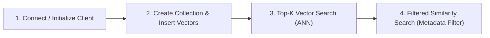

# Vector DB Playground 🚀

A comprehensive, hands-on developer playground for experimenting with, comparing, and benchmarking leading **Vector Databases**: **Qdrant**, **Milvus**, **Weaviate**, **Chroma**, **PostgreSQL + pgvector**, and **Pinecone**.

This repository is designed with a standardized project structure, shared sample dataset, Docker Compose orchestration for local testing, and uniform code workflows across every database implementation.

---

## 📑 Table of Contents

- [Vector Database Comparison Matrix](#-vector-database-comparison-matrix)
- [Repository Structure](#-repository-structure)
- [Standardized Code Lifecycle](#-standardized-code-lifecycle)
- [Sample Dataset](#-sample-dataset)
- [Local Infrastructure Setup (Docker Compose)](#-local-infrastructure-setup-docker-compose)
- [Running Hands-on Examples](#-running-hands-on-examples)
  - [1. Qdrant](#1-qdrant)
  - [2. Chroma](#2-chroma)
  - [3. PostgreSQL + pgvector](#3-postgresql--pgvector)
  - [4. Weaviate](#4-weaviate)
  - [5. Milvus](#5-milvus)
  - [6. Pinecone](#6-pinecone)
- [Clean-Up & Teardown](#-clean-up--teardown)
- [License](#-license)

---

## 📊 Vector Database Comparison Matrix

| Vector Database | Primary License | Deployment Model | Indexing Algorithms | Key Strengths / Pros | Limitations / Cons | Best Fit / Use Case |
| :--- | :--- | :--- | :--- | :--- | :--- | :--- |
| **[Qdrant](./qdrant)** | Apache 2.0 | Self-Hosted (Docker/K8s) or Qdrant Cloud | HNSW with Payload Filtered Graphs | • Ultra-fast Rust engine<br>• Payload-driven index filtering (no post-filtering hitches)<br>• Built-in Web UI dashboard<br>• Scalar & Product Quantization | • Distributed setup requires careful sharding planning<br>• Relatively young ecosystem compared to Postgres | Production-grade search, microservices, high-throughput filtering, edge & server deployments |
| **[Chroma](./chroma)** | Apache 2.0 | Embedded (In-Process) or Self-Hosted Docker | HNSW (`hnswlib` / native backend) | • Extremely easy to get started<br>• Runs embedded directly inside Python (no server required)<br>• Ideal for RAG prototypes & local LLM apps | • Not designed for billion-scale distributed datasets<br>• Historically lacked advanced distributed clustering | Local development, rapid prototyping, desktop AI applications, simple RAG pipelines |
| **[pgvector](./pgvector)** | PostgreSQL License | Self-Hosted (Docker/Cloud RDS/Aurora/Neon) | HNSW, IVFFlat | • Leverages existing PostgreSQL setup and tooling<br>• ACID compliance, transactions, and foreign keys<br>• Combine relational SQL queries with vector search directly | • Index build times and memory footprint higher than specialized engines<br>• Limited to single-node scaling unless using distributed Postgres | Applications already built on PostgreSQL that need vector search without introducing new infra |
| **[Weaviate](./weaviate)** | BSD 3-Clause | Self-Hosted (Docker/K8s) or Weaviate Cloud (WCS) | HNSW, Dynamic/Flat, Inverted Index | • Native Hybrid Search (BM25 + Dense Vectors)<br>• Modular AI model integrations (OpenAI, HuggingFace)<br>• Rich GraphQL and high-performance gRPC APIs<br>• Multi-tenancy support | • Memory usage can be substantial with large HNSW graphs<br>• Complex configuration options for beginner users | Enterprise search, hybrid search (keyword + semantic), multi-tenant SaaS, multi-modal applications |
| **[Milvus](./milvus)** | Apache 2.0 | Self-Hosted (Distributed K8s/Docker) or Zilliz Cloud | HNSW, IVF_FLAT, IVF_SQ8, SCaNN, DiskANN | • True distributed, cloud-native disaggregated architecture<br>• Scalable to billions of vectors<br>• GPU acceleration support<br>• Milvus Lite for embedded testing | • Heavy infrastructure footprint (requires etcd and MinIO in distributed mode)<br>• Higher operational complexity | Massive-scale enterprise systems, multi-billion vector search, high-concurrency enterprise workloads |
| **[Pinecone](./pinecone)** | Proprietary | Fully Managed Cloud SaaS (AWS, GCP, Azure) | Proprietary ANN Graph/Tree | • Zero infrastructure maintenance<br>• True serverless billing (pay-per-request)<br>• Enterprise-grade 99.99% availability SLA<br>• Fast metadata filtering and namespaces | • Closed source & vendor lock-in<br>• Recurring cloud costs<br>• Cannot be run completely offline or air-gapped | Teams that want zero DevOps overhead, rapid cloud deployment, and fully managed reliability |

---

## 📁 Repository Structure

```
vector-db-playground/
├── .env.example              # Environment variables template (ports, credentials, API keys)
├── .gitignore                # Ignored cache, data volumes, and virtual environment files
├── docker-compose.yml        # Multi-container orchestration for all local vector DBs
├── README.md                 # Primary documentation, architecture guide & comparison matrix
├── dataset/                  # Shared sample dataset
│   └── sample_embeddings.json
├── chroma/                   # Chroma implementation
│   ├── README.md             # Architecture, concepts & setup instructions
│   ├── main.py               # Standardized CRUD and similarity search implementation
│   └── requirements.txt      # Python dependencies (chromadb)
├── milvus/                   # Milvus implementation
│   ├── README.md             # Distributed architecture & setup instructions
│   ├── main.py               # Standardized CRUD and similarity search implementation
│   └── requirements.txt      # Python dependencies (pymilvus)
├── pgvector/                 # PostgreSQL + pgvector implementation
│   ├── README.md             # SQL vector operators & setup instructions
│   ├── schema.sql            # Table definition, extension enablement & HNSW index
│   ├── main.py               # Standardized CRUD and similarity search implementation
│   └── requirements.txt      # Python dependencies (psycopg2-binary, pgvector)
├── pinecone/                 # Pinecone (Cloud-based) implementation
│   ├── README.md             # Serverless cloud setup & API key instructions
│   ├── main.py               # Standardized CRUD, search & mock fallback simulation
│   └── requirements.txt      # Python dependencies (pinecone)
├── qdrant/                   # Qdrant implementation
│   ├── README.md             # Rust engine details & setup instructions
│   ├── main.py               # Standardized CRUD and similarity search implementation
│   └── requirements.txt      # Python dependencies (qdrant-client)
└── weaviate/                 # Weaviate implementation
    ├── README.md             # Modern v4 client, gRPC & hybrid search instructions
    ├── main.py               # Standardized CRUD and similarity search implementation
    └── requirements.txt      # Python dependencies (weaviate-client)
```

---

## 🔄 Standardized Code Lifecycle

Every `main.py` script across all vector database directories adheres to the same 4-step lifecycle:



1. **Step 1: Initialization / Connection**: Connect to the local container or cloud instance with graceful embedded fallback where supported.
2. **Step 2: Schema & Data Ingestion**: Cleanly recreate the target collection or table, configure the cosine distance metric, and insert sample documents, vectors, and metadata payloads.
3. **Step 3: Vector Similarity Search**: Execute top-3 approximate nearest neighbor (ANN) retrieval using the sample technology query vector.
4. **Step 4: Filtered Similarity Search**: Execute a filtered search restricted to a specific category (e.g. `culinary`) demonstrating how the engine combines metadata predicates with vector distance.

---

## 📦 Sample Dataset

The shared dataset is located at [`dataset/sample_embeddings.json`](./dataset/sample_embeddings.json):
- **Dimension**: 8-dimensional normalized unit vectors.
- **Metric**: Cosine similarity ($\text{sim}(u, v) = \frac{u \cdot v}{\|u\| \|v\|}$).
- **Domains Represented**:
  - `technology`: Articles on Vector DBs, LLM Agents, and Kubernetes Microservices.
  - `culinary`: Articles on Neapolitan Pizza Fermentation and Specialty Pour-Over Coffee.
  - `science`: Articles on James Webb Space Telescope and Exoplanet Biosignatures.
- **Sample Queries**: Contains pre-computed query vectors for testing both high-similarity retrieval and metadata filtering.

---

## 🐳 Local Infrastructure Setup (Docker Compose)

The root `docker-compose.yml` orchestrates all local databases with a single command:

```bash
# 1. Copy the environment configuration
cp .env.example .env

# 2. Launch all local vector databases in background
docker compose up -d
```

### Starting Individual Services

If you only want to test a specific database, start just its container:

```bash
# Start Qdrant only
docker compose up -d qdrant

# Start Chroma only
docker compose up -d chroma

# Start PostgreSQL + pgvector only
docker compose up -d pgvector

# Start Weaviate only
docker compose up -d weaviate

# Start Milvus standalone (with etcd & minio)
docker compose up -d milvus etcd minio
```

### Checking Service Health & Endpoints

| Service | Protocol / Port | Web Dashboard / Health URL |
| :--- | :--- | :--- |
| **Qdrant** | REST: `6333`, gRPC: `6334` | [http://localhost:6333/dashboard](http://localhost:6333/dashboard) |
| **Chroma** | HTTP: `8000` | [http://localhost:8000/api/v1/heartbeat](http://localhost:8000/api/v1/heartbeat) |
| **pgvector** | PostgreSQL: `5432` | `psql -h localhost -p 5432 -U postgres -d vectordb` |
| **Weaviate** | REST: `8080`, gRPC: `50051` | [http://localhost:8080/v1/meta](http://localhost:8080/v1/meta) |
| **Milvus** | gRPC: `19530`, Metrics: `9091` | MinIO UI: [http://localhost:9001](http://localhost:9001) (`minioadmin`/`minioadmin`) |
| **Pinecone** | Cloud HTTPS | [https://app.pinecone.io](https://app.pinecone.io) |

---

## 🚀 Running Hands-on Examples

### Prerequisites

- Python 3.10+
- Recommended: Create and activate a virtual environment:
  ```bash
  python3 -m venv .venv
  source .venv/bin/activate
  ```

---

### 1. Qdrant

```bash
pip install -r qdrant/requirements.txt
python qdrant/main.py
```
*Note: If the Qdrant container is not running, `main.py` automatically falls back to an in-memory client (`:memory:`).*

---

### 2. Chroma

```bash
pip install -r chroma/requirements.txt
python chroma/main.py
```
*Note: If the Chroma container is not running, `main.py` automatically falls back to an embedded persistent client (`chroma/chroma_data/`).*

---

### 3. PostgreSQL + pgvector

```bash
docker compose up -d pgvector
pip install -r pgvector/requirements.txt
python pgvector/main.py
```

---

### 4. Weaviate

```bash
docker compose up -d weaviate
pip install -r weaviate/requirements.txt
python weaviate/main.py
```

---

### 5. Milvus

```bash
# Option A: With Docker
docker compose up -d etcd minio milvus

pip install -r milvus/requirements.txt
python milvus/main.py
```
*Note: If the Milvus Docker containers are not running, `main.py` automatically falls back to embedded Milvus Lite (`milvus/milvus_demo.db`).*

---

### 6. Pinecone

```bash
pip install -r pinecone/requirements.txt
python pinecone/main.py
```
*Note: Pinecone is a cloud-managed SaaS database. If you have an API key, add `PINECONE_API_KEY` to `.env`. If not, `main.py` runs a mock simulation showcasing the exact API calls and computing cosine similarity locally.*

---

## 🧹 Clean-Up & Teardown

To stop and remove all local database containers and volumes:

```bash
# Stop containers
docker compose down

# Stop containers and wipe persistent data volumes
docker compose down -v
```

---

## 📄 License

This repository is licensed under the [MIT License](LICENSE). Each third-party vector database retains its respective open-source or commercial license as documented in the comparison matrix.
